# Chorly

A family chores hub: parents create chores, kids mark them done on their phones, parents approve, kids earn. A family map shows who's where, in Hebrew or English.

<table>
  <tr>
    <td width="33%">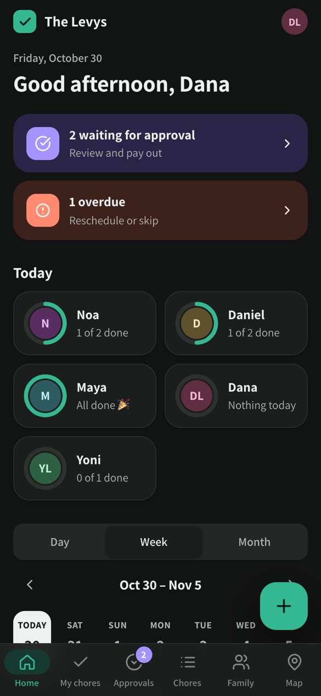</td>
    <td width="33%">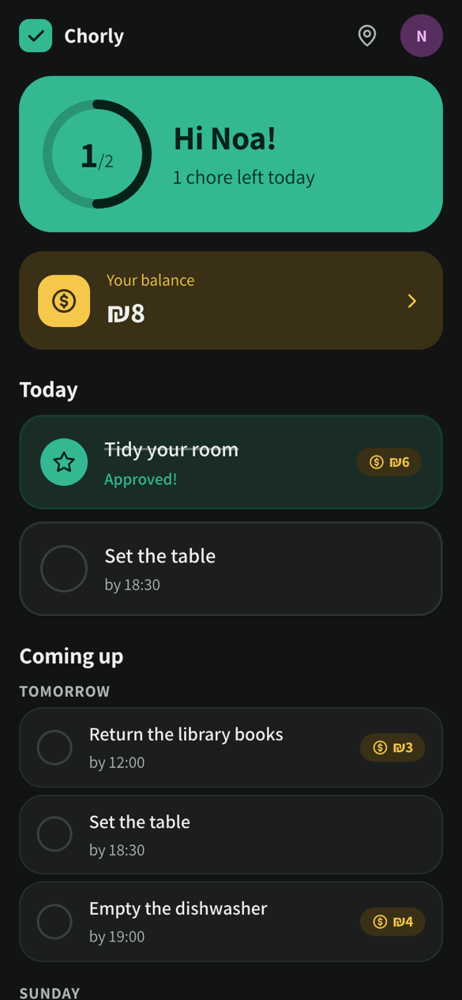</td>
    <td width="33%">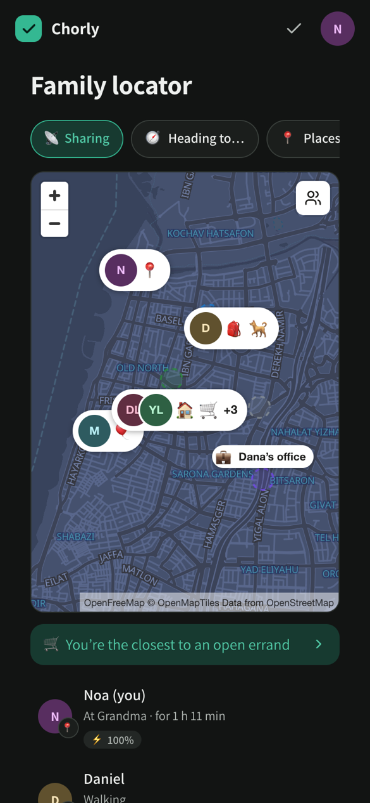</td>
  </tr>
  <tr align="center">
    <td>Parents run the week</td>
    <td>Kids check chores off and earn</td>
    <td>Everyone's on the map</td>
  </tr>
</table>

**Contents:** [User guide](#user-guide) · [Production on this Mac](#production-on-this-mac-docker-desktop) · [Family locator](#family-locator) · [Phones](#phones-install--notifications) · [Local development](#local-development)

- `apps/api`: NestJS + Prisma (Postgres). Served under `/api`.
- `apps/web`: Next.js 14, installable as an app (PWA) with push notifications.
- `apps/worker`: scheduler that generates chore occurrences and sends reminders.
- `packages/shared`: shared Zod schemas + types.
- `mobile`: Android app, a Capacitor wrapper around the live site.

Single family per install. The first visitor sets up the family (`/register`); after that, setup is locked and parents add members on **Family** (`/admin/users`). Anyone who signs in needs an email + password (any address works, it's only a username).

Login uses an httpOnly session cookie (90 days). Parents (`role=parent`) can manage everything; kids can only see and complete their own chores, and use the map. Chores can also be assigned to parents, themselves or each other: they check them off under **My chores** and it counts as approved straight away. Only kids earn rewards.

## User guide

The screenshots show a made-up family, the Levys.

### Getting started

1. Open Chorly and choose **Set up your family**. Enter the family name, your name, an email and a password. This only happens once: everyone else is added from inside the app.
2. Go to **Family → Add member** and add each kid, and any other parent. Pick a name, an email or username, a password of at least 8 characters, and a language.
3. Add a few chores (below).
4. Each person signs in on their own phone, [installs Chorly](#phones-install--notifications) and turns on notifications under **Account**.

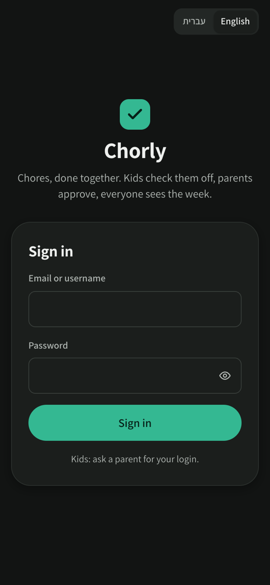

### Parents: your week at a glance

**Home** shows what needs you first: chores waiting for approval and anything overdue. Below that is each person's progress today (tap someone to see only their chores) and a calendar you can switch between **Day**, **Week** and **Month**.

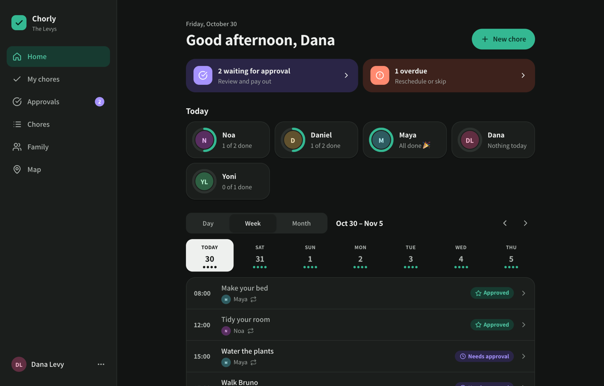

Tap a chore in the calendar to **Change time or who** for that one occurrence, **Edit the chore** for all upcoming ones, or **Skip just this one**.

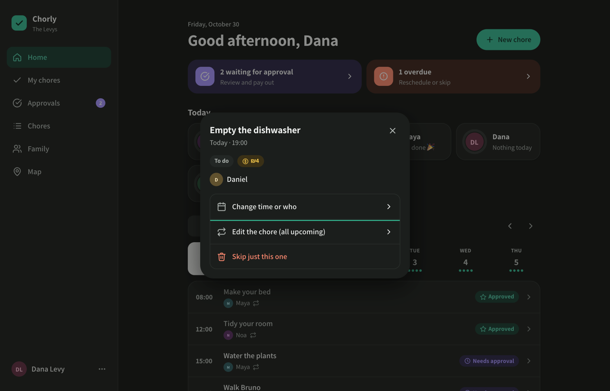

### Parents: adding chores

Tap **New chore** (the **+** button on a phone), or a suggestion under **Chores → Quick add**.

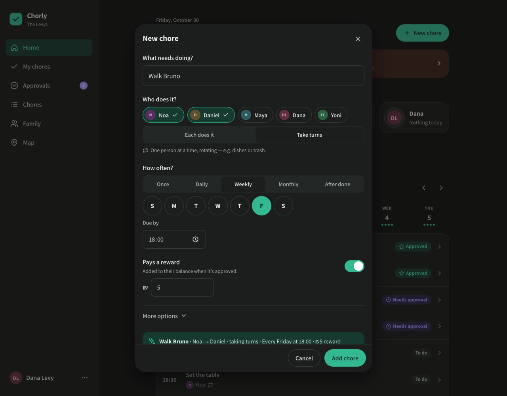

- **Who does it?** Pick one person or several. With several, **Each does it** gives everyone their own copy ("clean your room"), and **Take turns** rotates it between them ("dishes").
- **How often?** **Once**, **Daily**, **Weekly** on the days you choose, **Monthly** on the first or last of a weekday, or **After done**, where the next one is due a number of days after the last was finished.
- **Pays a reward** adds the amount to a kid's balance when the chore is approved.
- **More options:**
  - **Ends**: when a repeating chore stops.
  - **Counts as late after**: how long after the due time it turns overdue.
  - **Tied to a place**: the kid can mark it done only while at a family place (**Be there**), or after visiting it that day (**Visit that day**).
  - **Skip people who are away**: leaves out anyone marked Away.
  - **Save as a suggestion**: adds it to Quick add.

**Chores** lists everything your family does, with a filter by person. Tap a chore to edit it (changes apply to upcoming occurrences) or delete it (rewards already approved stay). **Edit** next to Quick add changes the suggestions.

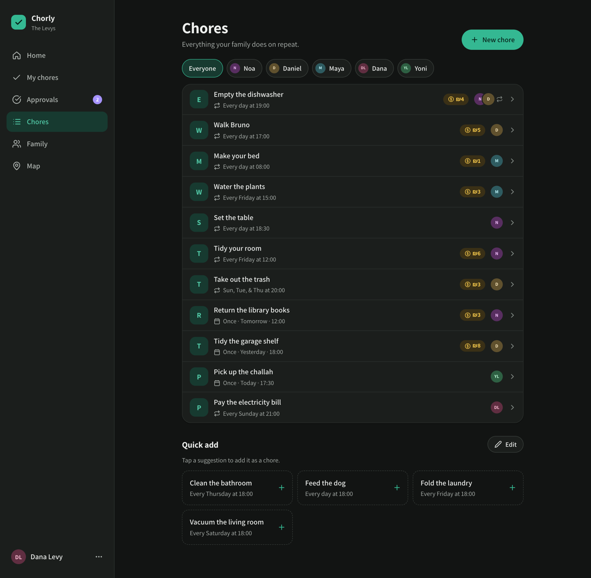

### Parents: approving and paying

When a kid finishes a chore it lands in **Approvals**, with their photo or video if they added one. You can change the reward before approving, or use **Approve all**. **Reject** sends the chore back to not done, with an optional reason, and pays nothing. The **Overdue** list below is where you reschedule or skip what was missed. The **⋯** button on a waiting chore has the same options as tapping it on Home.

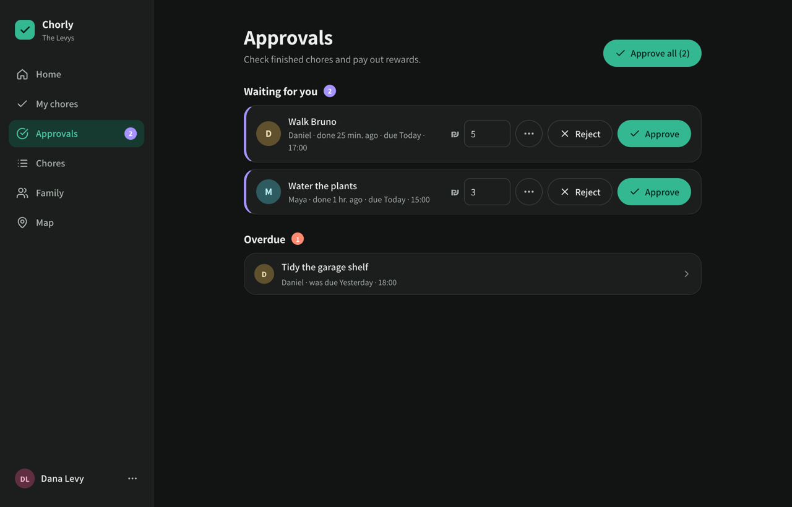

**Family** shows each kid's balance. **Mark paid** resets it to zero once you've handed over the money. **See Noa's view** opens the app as that kid sees it. Tap a member to edit them or reset their password; turn on **Away** for a kid on a trip or at camp, and new chores skip them.

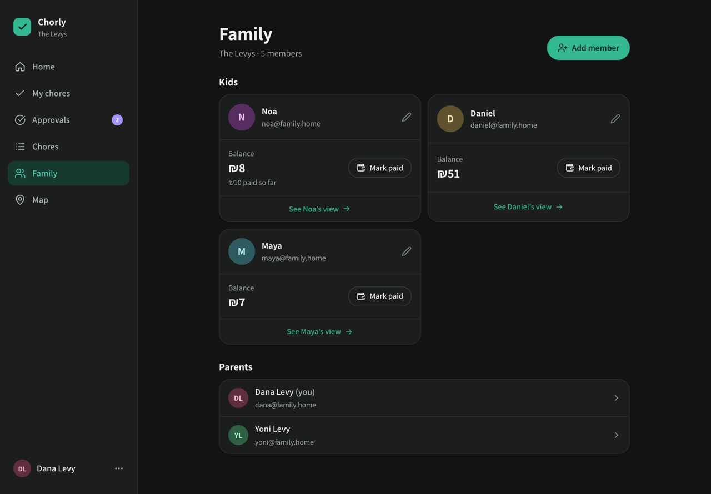

Parents' own chores are under **My chores**. Tapping one approves it right away, and tapping it again takes it back. The chips at the top show anyone else's list, read-only.

### Kids: doing chores

Your page shows how far along you are today, your balance, today's chores, anything you missed from the past week, and what's coming up.

1. Tap a chore.
2. Choose **Mark done**, or **Add proof** to take a photo or a video of up to 15 seconds. Proof only comes from the live camera, not the gallery.
3. It now says **Waiting for a parent to approve**. Tap it again if you change your mind.
4. Once approved you get a star, and any reward joins your balance. If a parent rejects it, it comes back as not done, with a notification and their reason if they gave one.

Tap your balance to see what you've earned and been paid.

<table>
  <tr>
    <td width="33%"></td>
    <td width="33%">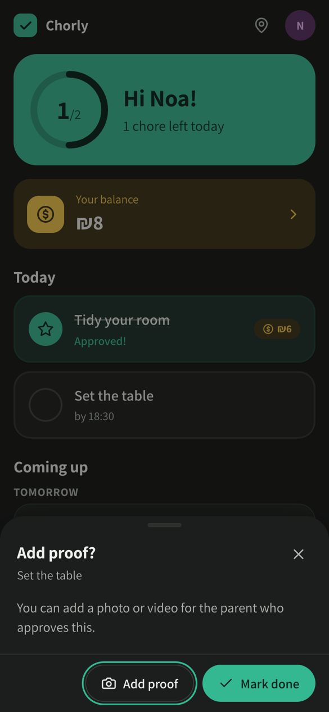</td>
    <td width="33%">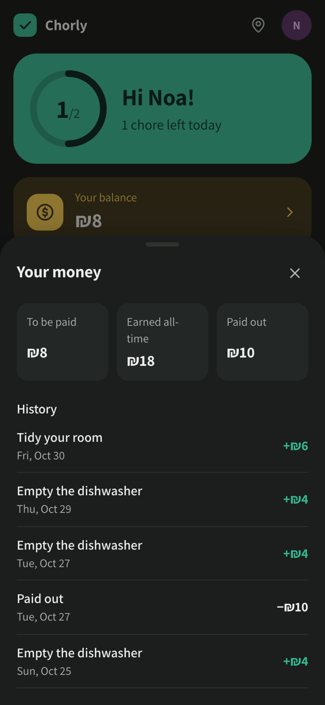</td>
  </tr>
</table>

### The family map

Open **Map** (kids: the pin at the top). The first time, turn on **Share my location from this device** and choose what the family sees and for how long. Sharing is opt-in and per device, and you can change it any time from the chip in the toolbar.

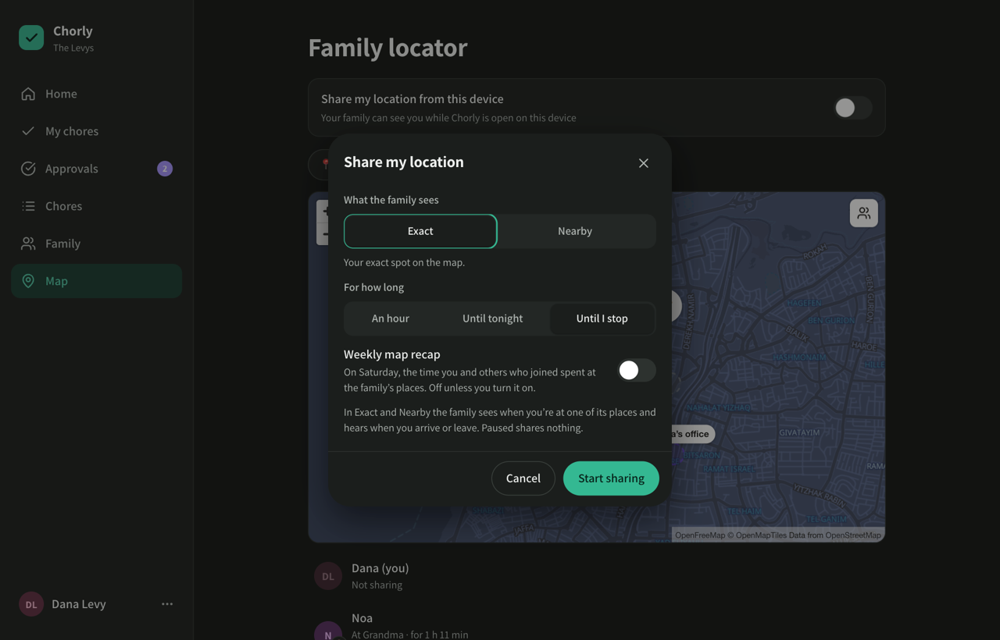

| Mode | What the family sees |
|------|----------------------|
| **Exact** | Your spot on the map |
| **Nearby** | Only your neighbourhood, with no street or speed |
| **Paused** | That you paused, and nothing else |

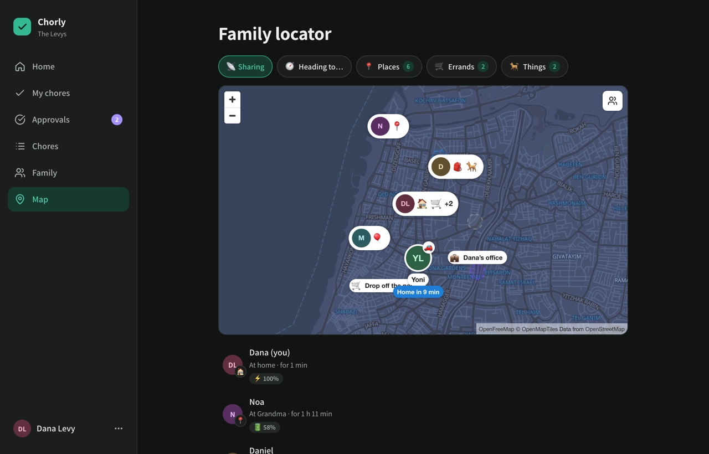

- **Tap someone** to see their status, get directions, or send a sticker such as "Dinner's ready".
- **Heading to…** shares an estimated arrival, as a bubble on your picture.
- **Places** are spots like home and school. The family hears when someone arrives or leaves. Parents add them, from an address, a pin or their current location. A place can also pay a kid a reward on their first arrival each day.
- **Errands** are tasks pinned to a spot, like "Pick up milk". Whoever is closest gets a nudge, anyone can **Claim it**, and passing nearby reminds you.
- **Things** are the dog, a bike or the car. Add them and move them by hand.

<table>
  <tr>
    <td width="33%">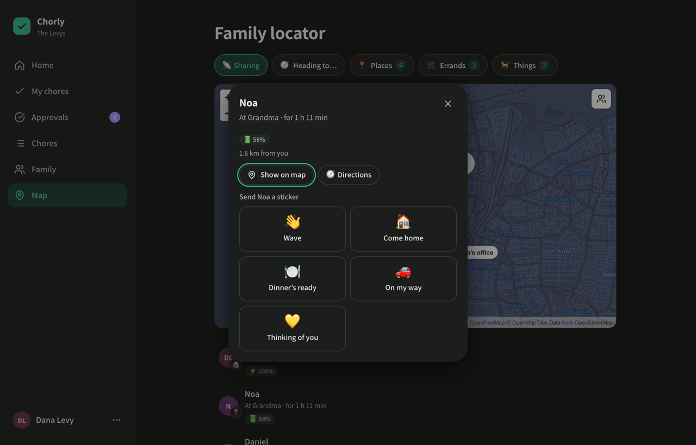</td>
    <td width="33%">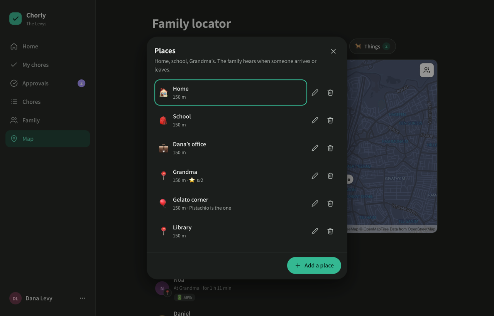</td>
    <td width="33%">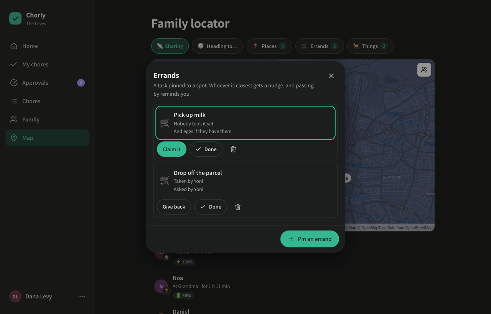</td>
  </tr>
</table>

In a browser or home-screen app, you only share while Chorly is open and on screen. The Android app keeps sharing in the background. See [Family locator](#family-locator) for the details and what's stored.

### Your account

Tap your picture for **Account**:

- **Profile picture**: from your gallery or the camera, then drag and zoom to frame it.
- **Language**: Hebrew or English, for the app and your notifications. Hebrew runs right to left.
- **Notifications**: turn them on for this device.
- **Choose notifications**: switch each type on or off.
- **Get the Android app**: shown in Android browsers.
- **Log out**

<table>
  <tr>
    <td width="66%">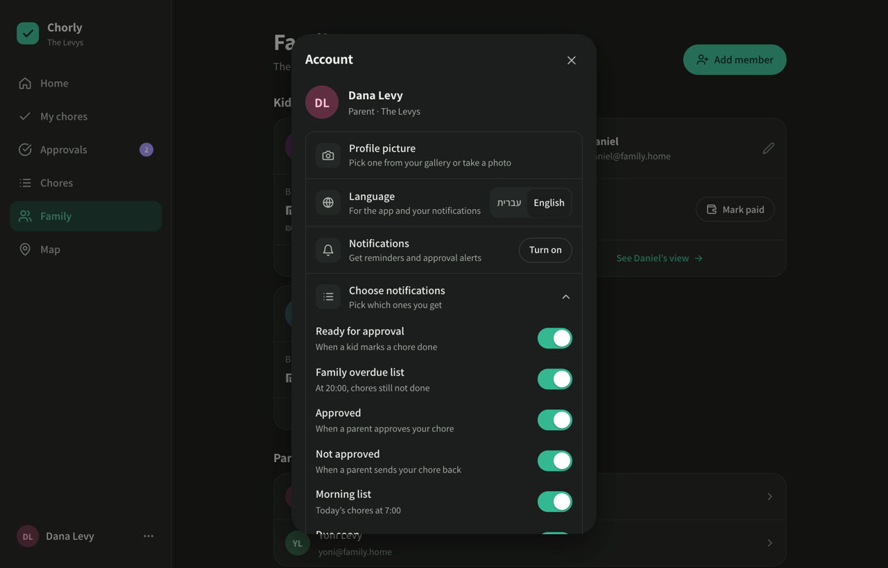</td>
    <td width="33%">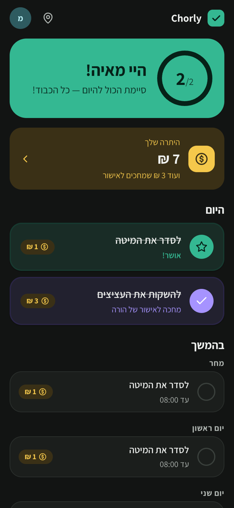</td>
  </tr>
</table>

## Production on this Mac (Docker Desktop)

The stack in `docker-compose.yml`:

| service  | what it does |
|----------|--------------|
| caddy    | HTTPS with automatic Let's Encrypt certs, routes `/api` → api, everything else → web |
| api, web, worker | the app (one image built from `Dockerfile`) |
| postgres | database (not exposed outside Docker) |
| backup   | nightly `pg_dump` into `./backups`, keeps 14 days |
| ddns     | keeps the DNS record pointed at your home IP (opt-in profile) |
| cast     | keeps the chores board on a Nest Hub during the day (opt-in profile) |

### 1. DNS + dynamic IP

Pick a hostname, e.g. `chores.the-raifs.me`.

**Recommended: move DNS to Cloudflare (free).** GoDaddy only allows API access (needed for DDNS) on accounts with 10+ domains, so their API usually returns 403 for personal accounts. You keep the domain registered at GoDaddy and only change its nameservers:

1. Create a free Cloudflare account → *Add a site* → `the-raifs.me` → Free plan. It imports your existing records.
2. In GoDaddy → *Domain* → *DNS* → *Nameservers* → *Change* → enter the two Cloudflare nameservers.
3. In Cloudflare, add an `A` record `chores` → your current public IP, **DNS only** (grey cloud).
4. Create an API token: *My Profile → API Tokens → Create Token → Edit zone DNS* template, zone `the-raifs.me`.
5. `cp deploy/ddns/config.cloudflare.example.json deploy/ddns/config.json` and fill in the token and the Zone ID (on the domain's Overview page).

If you do have GoDaddy API access, use `deploy/ddns/config.godaddy.example.json` instead (keys from developer.godaddy.com, *Production*).

The ddns updater has a status page on its own port only inside Docker; check `docker compose logs ddns`.

### 2. Router

Forward TCP **80** and **443** (and UDP 443 optionally) to this Mac's LAN IP. Give the Mac a DHCP reservation so its LAN IP doesn't change.

### 3. Configure and start

```bash
cp .env.example .env
```

Edit `.env`: set `POSTGRES_PASSWORD` (`openssl rand -hex 24`) and VAPID keys (`npx web-push generate-vapid-keys`). Then:

```bash
docker compose --profile ddns up -d --build
```

Open `https://chores.the-raifs.me` and set up the family. Caddy gets the certificate on first request (DNS must already point at you and ports must be forwarded).

### 4. Keep the Mac serving

- Docker Desktop → Settings → General → *Start Docker Desktop when you sign in*.
- System Settings → Energy → *Prevent automatic sleeping when the display is off* (or `sudo pmset -a sleep 0`).
- All containers use `restart: unless-stopped`.

### Updating

```bash
git pull
docker compose --profile ddns up -d --build
```

Database migrations run automatically when the api container starts.

### Chore photos and videos

Proofs live in the `chorly_proofs` Docker volume only until a parent approves or rejects the chore, then they're deleted. They aren't part of the nightly backup.

Profile pictures are stored in Postgres, so the nightly backup includes them.

### Kitchen display

A read-only board of today's chores for each kid, for a Nest Hub or a tablet. It shows names, chores and pictures, but no money, proofs, locations or parents' chores.

1. In the app, go to **Family → Kitchen display → Create link** and copy the link. It's shown once. **New link** replaces it and **Turn off** ends it.
2. Find the Hub's IP in the Google Home app (*Device → Settings → Device information*), and reserve it on the router so it doesn't change.
3. Add both to `.env`, along with the hours the board should be up:

   ```bash
   HUB_IP=192.168.10.18
   DISPLAY_URL=https://chores.the-raifs.me/display/...
   CAST_FROM=07:00
   CAST_UNTIL=21:00
   ```

4. Let Docker reach the Hub: System Settings → Privacy & Security → Local Network → turn Docker on, then restart Docker Desktop. If it's already on and the `cast` logs still show `Can't reach the Hub`, turn it off and on again, then restart Docker Desktop.
5. Start it:

   ```bash
   docker compose --profile ddns --profile cast up -d --build
   ```

The `cast` service checks the Hub every 30 seconds. If it's idle during those hours, the board goes back up. If it's playing something else, it's left alone until that ends. After `CAST_UNTIL` the board comes off. See what it's doing with `docker compose logs -f cast`. Casting relies on catt and DashCast, not on anything Google supports, so a Hub firmware update can break it.

For a tablet, open the link in a kiosk browser instead. The `cast` service isn't needed.

### Restore a backup

```bash
gunzip -c backups/chorly-YYYY-MM-DD.sql.gz | docker compose exec -T postgres psql -U chorly chorly
```

## Family locator

Everyone, kids included, can open the map (**Map** tab, or the pin at the top for kids) and turn on **Share my location from this device**. That card only asks once: after that, a chip in the map toolbar shows the sharing state and opens its settings. The switch is per device, so a laptop doesn't pull someone away from the phone in their pocket, and sharing is opt-in: the location only leaves the device once its owner turns this on.

Only the last known position is kept (`UserLocation`), never a history. Turning sharing off deletes it. The map is drawn with MapLibre using free OpenFreeMap styles (Positron in light mode, Fiord in dark), which need no key.

**In a browser or installed web app, sharing only runs while Chorly is open and on screen.** They get no location once they're in the background or closed, on both iPhone and Android. Someone who leaves the app stays on the map at their last position, labelled with how long ago that was and faded after 10 minutes.

**The Android app keeps sharing in the background**, with a permanent "Sharing your location" notification while it does. Swiping the app away stops it, and some phones' battery savers can too.

### Places, alerts and the rest of the map

- **How you share.** The share sheet picks what the family sees (**Exact**, **Nearby** for only the neighbourhood, a couple of kilometres wide with no street or speed, or **Paused**, which shows as paused rather than silently disappearing) and for how long (an hour, until tonight, or until you stop). A timed share forgets the position by itself. Switching to Nearby blurs the stored position at once, on the server.
- **Places** (parents add them; everyone sees them): home, school, work, a favourite spot with a note, or anything else, each a circle on the map. The spot comes from an address (looked up through OpenStreetMap's Nominatim by the API, so the family's devices never talk to it), a pin on the map, or the phone's location. Arriving at or leaving one sends a push to the rest of the family (`placeAlerts`). A phone has to be well inside or outside the circle, with a decent fix, before it counts, so GPS jitter on the edge doesn't spam the family.
- **Chores meet the map.** Arriving at a *home* place sends the person today's open chores. Reminders for overdue and due-soon chores wait while someone is at a *school* or *work* place. A chore can be tied to a place (chore editor, more options): the child can mark it done only while at the place, or only after visiting it that day. Parents are exempt. A place can also pay a child a reward the first time they arrive each day.
- **Errands.** Pin a task on the map ("pick up milk"). The nearest sharing member gets a nudge and can claim it; passing within 300 m reminds whoever took it, or anyone if nobody has. Whoever pinned it isn't nudged, and hears when someone takes it and when it's done. Once taken, only that person or a parent can finish or give it back.
- **Things.** The dog, a bike, the car: put them on the map and move them by hand.
- **Heading to…** Share an estimated arrival at a place, as a bubble on your avatar. The estimate is straight-line distance with a route factor, not a routing service.
- **Status.** Each person gets a battery chip and a status bubble worked out from where they are and how fast they move (home, school, walking, driving, asleep). People standing within 80 m of each other show as together. When zoomed out, anything that would collide on the map merges into one bubble; a tap zooms in, and at street level people at the same spot stand side by side. Markers glide into a bubble and back out of it. A tap on someone shows their details and directions, and sends a sticker (wave, come home, dinner's ready). A status that's out of date doesn't pretend otherwise: an old position shows no speed, battery or arrival estimate.
- **Phone alerts for parents.** Battery at or under 15% and not charging, or, for Android app users, no update for 45 minutes during the day.
- **Weekly recap** (Saturday 19:30, opt-in per member): time at the family's places over the past week, sent only to members who joined it, about members who joined it.

The only trail kept is `PlaceVisit`, the stays at the family's own places, and the worker deletes visits 14 days after they end (`location-watch`). Everything else is still the last known position only. Alert types can each be turned off under **Choose notifications**. Alerts for places work in Exact and Nearby, and Nearby still shows which of the family's places someone is at. Paused shares nothing.

## Phones (install + notifications)

- **Android app:** install the APK (see below), then tap **Turn on** next to **Notifications** under Account.
- **Android / Chrome:** open the site → menu → *Install app*, then tap **Turn on** next to **Notifications** under Account.
- **iPhone (iOS 16.4+):** open in Safari → Share → *Add to Home Screen*, open Chorly from the icon, then tap **Turn on** next to **Notifications** under Account. iOS only allows web push for home-screen apps.

### Android app

`mobile/` is a Capacitor wrapper that loads the live site, so web and API deploys reach it without a new APK. Rebuild only when something in `mobile/` changes (plugins, permissions, icon); bump `versionCode` in `mobile/android/app/build.gradle` first.

Building needs JDK 21 and the Android SDK (platform 35, build-tools 35):

```bash
cd mobile
npm install
export JAVA_HOME=/opt/homebrew/opt/openjdk@21 ANDROID_HOME=/opt/homebrew/share/android-commandlinetools
npm run apk
```

The APK is copied to `deploy/apk/chorly.apk`, which is what family members download under **Account → Get the Android app** (signed-in Android browsers only). A new build goes live right away, with no deploy. It's signed with `mobile/android/chorly-release.keystore` and the passwords in `keystore.properties`, both outside git. Back them up: phones only accept an update signed with the same key.

**Notifications** go through Firebase, so they need a free Firebase project with an Android app using the package name `me.theraifs.chorly`:

1. Put its `google-services.json` in `mobile/android/app/` and rebuild. An APK built without it works, but offers no notifications.
2. In *Project settings → Service accounts*, generate a private key and put it in `.env` as `FIREBASE_SERVICE_ACCOUNT` (`base64 -i key.json`), then `docker compose up -d`.

Notifications sent:
- Kid marks a chore done → parents ("ready for approval").
- Parent approves → kid (with reward).
- Parent rejects → kid (with the reason, if given); the chore goes back to not done.
- 07:00 today's chores.
- 30 minutes before a chore's due time → the kid (once per chore; only chores with a time set, none during quiet hours `21:00-07:00`).
- 17:00 + 20:00 overdue chores → the kid. Each chore at most once a day, and only for 3 days after it was due.
- 20:00 overdue chores across the family → parents.
- Saturday 19:00 weekly summary: kids get their own week, parents get the family's.
- Every 5 minutes, `location-watch`: ends timed shares, alerts parents to low batteries and quiet phones, and tidies old visits, errands and trips.
- Saturday 19:30 map recap for members who opted in.

Nobody is notified about their own action (a parent approving their own chore, say). Each member can turn any type off under **Account → Choose notifications**; this applies to email too.

Times are configurable with `CRON_*` env vars on the worker (see `apps/worker/src/scheduler.ts`), plus `DUE_SOON_MINUTES`, `OVERDUE_MAX_DAYS` and `QUIET_HOURS`.

## Local development

```bash
pnpm install
docker compose -f docker-compose.dev.yml up -d
cp apps/api/.env.example apps/api/.env
cp apps/worker/.env.example apps/worker/.env
pnpm db:generate
pnpm db:migrate
pnpm db:seed   # optional sample family; password Password123!
pnpm dev
```

- Web: http://localhost:3000 (proxies `/api` to the API on :4000)
- Swagger: http://localhost:4000/api/docs (when `ENABLE_SWAGGER=true`)

Run a worker job once:

```bash
pnpm --filter chorly-worker generate
pnpm --filter chorly-worker reminders:morning
pnpm --filter chorly-worker reminders:due-soon
pnpm --filter chorly-worker reminders:overdue
pnpm --filter chorly-worker reminders:parents
pnpm --filter chorly-worker summary:weekly
pnpm --filter chorly-worker location:watch
pnpm --filter chorly-worker summary:places
```
